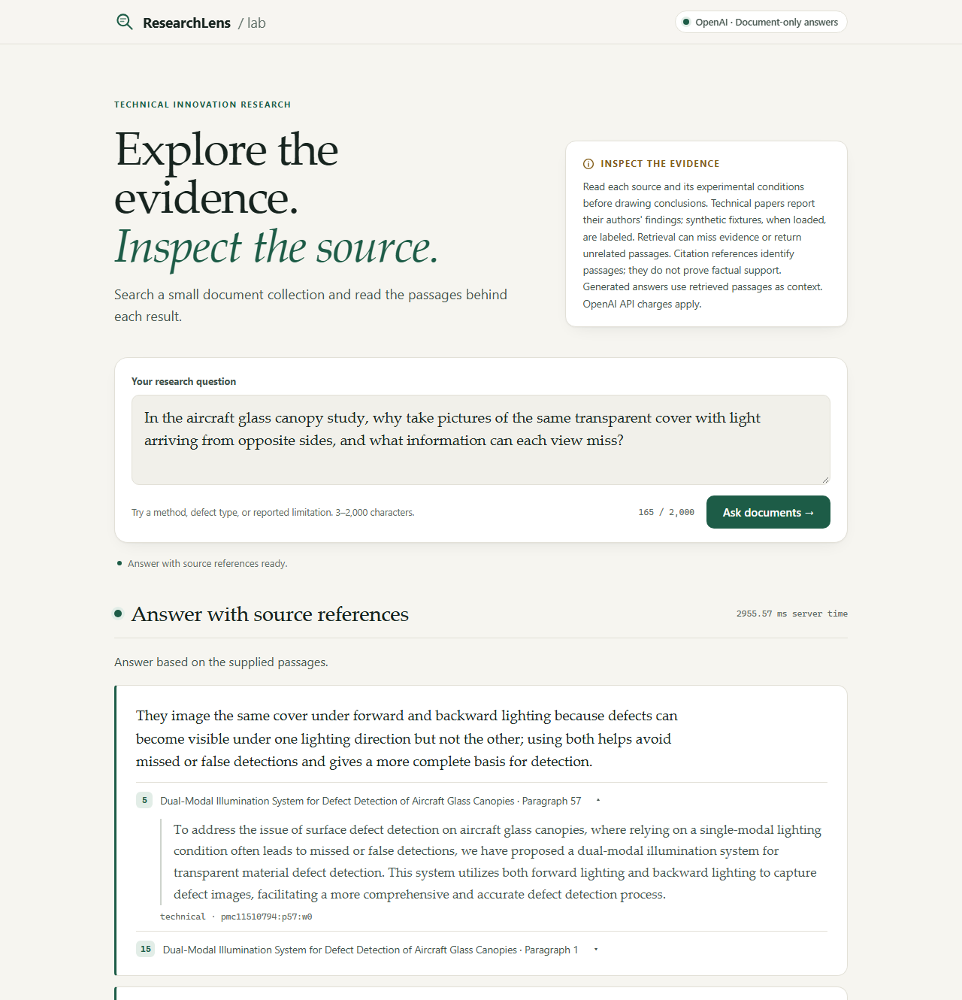
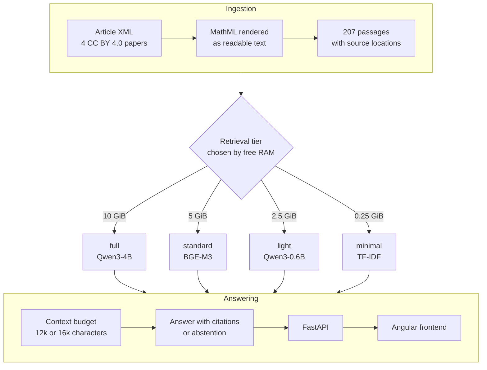

# ResearchLens

[](https://github.com/Timerk/ResearchLens/actions/workflows/ci.yml)
[](LICENSE)
[](data/technical/NOTICE.txt)

ResearchLens answers questions about technical papers using only the papers' own text.
Each part of an answer cites the passages it came from, and each citation opens to
show the source section, XML location, authors and license. When the passages do not
support an answer, it returns an explicit insufficient-evidence response. It is built
for engineers and researchers who need to check where a claim comes from. The bundled
corpus is four open-access CC BY 4.0 papers on optical defect inspection. The retrieval and answer pipeline was evaluated
with owner-approved questions, a held-out set run once, and pre-registered decision
rules.



*The answer shown was generated by `gpt-6-luna` during the 2026-10-15 development
evaluation and replayed from the saved run for this screenshot. No API call was made.
More screenshots: [full answer](docs/images/desktop-answer-full.png),
[mobile](docs/images/mobile-answer.png) and
[local preview without an API key](docs/images/desktop-local-preview.png).*

## Quickstart

```sh
git clone https://github.com/Timerk/ResearchLens.git
cd ResearchLens
docker compose up --build
```

Open <http://127.0.0.1:4200> and ask, for example, *Why combine forward and backward
lighting for aircraft glass canopy inspection?* This starts the minimal tier, TF-IDF
retrieval, with no model downloads. Without an API key the app shows the ranked passages
selected by the same context budget as OpenAI mode, with full text and source metadata.
Generated answers need `OPENAI_API_KEY` in `.env`; see
[`.env.example`](.env.example). [docs/docker.md](docs/docker.md) covers the dense
tiers (`RETRIEVAL_TIER=auto` or `full`) and records a fresh-clone check.
[docs/development.md](docs/development.md) covers running without Docker.

## Architecture



Ingestion turns the papers' XML into passages that keep section paths and paragraph
locations. At startup, auto mode loads the largest tier that fits in available RAM and
falls back to the next one if loading fails. The backend fills a character budget with
the top-ranked passages and sends them to the answer provider. The provider is either
a free local preview, which lists passages without an answer, or OpenAI. The backend
rejects any answer that cites an unknown passage or leaves a section uncited. Without a tier setting, the application default
is TF-IDF with four passages.

## Results at a glance

| Study | Result | Source |
| --- | --- | --- |
| Development retrieval | Qwen3-4B at 12k and 16k characters meets all five retrieval targets | [formula-adoption-results.md](docs/formula-adoption-results.md) |
| Held-out retrieval, pre-registered, run once | Qwen3-4B meets 4 of 5 strict targets. Recall@4 is 77.6%, below the 80% target. All five pass under the development whole-context convention | [held-out-results.md](docs/held-out-results.md) |
| Answer quality, development only | Complete required claims rise from 19/36 with TF-IDF and four passages to 32/36 with Qwen3-4B 16k and BGE-M3 16k | [answer-quality.md](docs/answer-quality.md) |
| Answer judge | Certified for required claims and abstention only. Application defaults unchanged | [answer-quality.md](docs/answer-quality.md#current-decision-2026-10-15) |

[docs/results.md](docs/results.md) walks through the whole sequence, from the original
problem to the answer-quality decision.

## How it was evaluated

- The project owner approved 86 evaluation questions, 50 for development and 36 held
  out, and separately approved the development evidence labels.
- The held-out set was frozen before model selection. Its protocol was committed
  before the first held-out search, and it ran once. The report includes the missed
  target.
- The owner and Codex independently graded 60 blind judge items. The judge was frozen
  before anyone opened the sealed validation half, and validation ran once.
- Decisions use paired, two-sided exact McNemar tests on the same questions. A
  pre-registered rule decided whether to change a default.
- Every paid evaluation run had an approved cost plan and a hard cap. All 449 calls in the latest answer
  study cost $0.2469 at the supplied rates, under a $3 cap.

## Tech stack

| Area | Tools |
| --- | --- |
| Backend | Python 3.13, FastAPI, scikit-learn TF-IDF, PyTorch, Transformers and ONNX Runtime on CPU |
| Models | Qwen3-Embedding 4B and 0.6B, BGE-M3, MiniLM, OpenAI Responses API with `gpt-6-luna` |
| Frontend | Angular 21, Vitest, Playwright |
| Tooling | uv, Ruff, pytest, Docker Compose, GitHub Actions |

## Project structure

```text
backend/researchlens/  API, ingestion, retrieval, answers, evaluation
backend/tests/         Offline pytest suite, no paid calls
frontend/              Angular app, Vitest and Playwright tests
data/technical/        Four CC BY 4.0 papers, extracted text, NOTICE
evaluation/            Approved datasets, labels, reviews, cost plans
docs/                  Results and guides, start at docs/README.md
```

## Limitations

- The samples are small. With 36 answerable development questions and 26 held-out
  ones, the confidence intervals are wide.
- Most tuning used the development set. The held-out confirmation ran once and missed
  the recall@4 target.
- The answer judge is unreliable for qualifications, citation support and forbidden
  claims, so those results are diagnostics only.
- The full tier needs about 10 GiB of free RAM and an 8 GB model download. The minimal
  tier runs anywhere but retrieves less evidence.
- The corpus has four papers. Text extraction drops figures, tables and four
  unsupported formulas.

## License

The code and documentation are under the [MIT License](LICENSE). The four papers and
their extracted text keep their authors' copyright and CC BY 4.0 licenses. See
[data/technical/NOTICE.txt](data/technical/NOTICE.txt) for attribution and the changes
made during extraction.

## Development disclosure

The code, tests and documentation were written with AI assistance. The project owner
set the goals, constraints and budget, approved the 86 evaluation questions on
2026-10-01, and graded the judge validation items together with Codex. See the
[owner review](evaluation/reviews/2026-10-14-answer-judge/owner-review.md) for the
adjudication.
