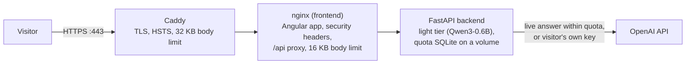

# Deployment and operations

This guide puts ResearchLens online as a public demo on one small Linux server. It
uses the same Docker Compose stack as local development, plus
[`docker-compose.prod.yml`](../docker-compose.prod.yml), which adds Caddy for HTTPS.
Expect about an hour the first time, most of it waiting for DNS and builds.

## Architecture



- Only Caddy publishes ports (80 and 443). The backend and nginx are reachable only on
  the internal Compose network.
- `RETRIEVAL_TIER=auto` with only the light index built resolves to the light tier and
  falls back to minimal (TF-IDF) if light cannot load.
- Live answers are limited per visitor and per day. Counts persist in SQLite on the
  `live-quota` volume, so restarts and redeploys do not reset them.
- Caddy writes no access log, so visitor IP addresses are not stored on disk. The quota
  store keeps only keyed hashes of the address and day.

| Request | What happens | Cost |
| --- | --- | --- |
| Recorded example (`GET /api/examples/{id}`) | Replays a saved evaluation answer | Free, no API call |
| Question, live answers off or used up | Local preview: ranked passages, no answer | Free, no API call |
| Question within the daily limit | Live `gpt-6-luna` answer with citations | Your OpenAI account |
| Question with a visitor's own key | Live answer on the visitor's key, no quota used | Visitor's OpenAI account |

## 1. Before you start

You need:

- A server: 2 vCPU, 4 GB RAM, 40 GB disk, Ubuntu 24.04 LTS, x86. The live demo runs on a
  Hetzner Cloud CPX22 in Helsinki at about 20 EUR a month including VAT and IPv4, billed
  hourly; the cheaper cost-optimized CX23 (about 7 EUR) fits too when in stock. Any
  provider works. With 2 GB, set `RETRIEVAL_TIER=minimal` (TF-IDF, no model download).
- A hostname: a domain or subdomain you control, or a free `sslip.io` name such as
  `203-0-113-7.sslip.io`, which resolves to the IP in its name and gets a normal Let's
  Encrypt certificate.
- An SSH key pair on your computer (`ssh-keygen -t ed25519` if you have none).
- Optional: an OpenAI API key for live answers and a Cloudflare account for Turnstile.

## 2. Set the OpenAI budget first

Do this before any live answer is possible.

1. In the OpenAI dashboard, open **Settings > Organization > Limits** (or **Billing >
   Limits**, depending on the current layout).
2. Set a **monthly budget** of, for example, 5 USD and enable the hard stop if offered.
3. Add an **email alert** at a lower threshold, for example 3 USD.
4. Create a **project-scoped API key** used only by this demo, so you can revoke it
   without affecting anything else.

When OpenAI rejects a request because of a rate or budget limit, the backend answers
with HTTP 429 and the free local preview instead of an error. With the default limits
(50 live answers a day) and the owner-supplied 2026-10-13 rates for `gpt-6-luna`
(0.10 USD per million input tokens, 0.50 USD per million output tokens), the worst case
is roughly 0.002 USD per answer, under 0.10 USD a day and about 3 USD a month. The
recorded evaluation study averaged 0.00055 USD per call. Check current prices before
relying on these numbers. (The average covers both generation and judge calls.)

## 3. Create the server

1. Create the server with Ubuntu 24.04, add your SSH public key, and enable IPv4 and IPv6.
2. Attach a firewall (Hetzner Cloud Firewall or `ufw`) that allows inbound TCP 22, TCP 80,
   TCP 443 and UDP 443 only.
3. Log in and prepare the system:

```sh
ssh root@SERVER_IP
apt update && apt -y full-upgrade
apt -y install git curl unattended-upgrades
dpkg-reconfigure -plow unattended-upgrades

# A deploy user with your SSH key; password logins off.
adduser --disabled-password --gecos "" deploy
install -d -m 700 -o deploy -g deploy /home/deploy/.ssh
cp ~/.ssh/authorized_keys /home/deploy/.ssh/ && chown deploy:deploy /home/deploy/.ssh/authorized_keys
sed -i 's/^#\?PasswordAuthentication .*/PasswordAuthentication no/' /etc/ssh/sshd_config
systemctl reload ssh

# 2 GB swap protects the 4 GB server from out-of-memory kills during model loading.
fallocate -l 2G /swapfile && chmod 600 /swapfile && mkswap /swapfile && swapon /swapfile
echo '/swapfile none swap sw 0 0' >> /etc/fstab
```

## 4. Install Docker

Use Docker's official apt repository
([docs](https://docs.docker.com/engine/install/ubuntu/)):

```sh
install -m 0755 -d /etc/apt/keyrings
curl -fsSL https://download.docker.com/linux/ubuntu/gpg -o /etc/apt/keyrings/docker.asc
echo "deb [arch=$(dpkg --print-architecture) signed-by=/etc/apt/keyrings/docker.asc] \
  https://download.docker.com/linux/ubuntu $(. /etc/os-release && echo "$VERSION_CODENAME") stable" \
  > /etc/apt/sources.list.d/docker.list
apt update && apt -y install docker-ce docker-ce-cli containerd.io docker-buildx-plugin docker-compose-plugin
usermod -aG docker deploy
docker compose version   # needs 2.24 or newer for the !reset tag in docker-compose.prod.yml
```

Docker publishes container ports directly through iptables and bypasses `ufw`. That is
fine here because only Caddy publishes ports, but keep the provider firewall as well.

## 5. Point DNS at the server

At your DNS provider, create records for the hostname:

| Type | Name | Value |
| --- | --- | --- |
| A | `researchlens` (or `@`) | the server's IPv4 address |
| AAAA | `researchlens` (or `@`) | the server's IPv6 address |

Wait until `dig +short researchlens.example.com` returns the server address. If you use
Cloudflare DNS, set the records to **DNS only** (grey cloud). Behind Cloudflare's
orange-cloud proxy, Caddy would see Cloudflare's address instead of the visitor's, and
every visitor would share one quota, unless Caddy's `trusted_proxies` were configured
for Cloudflare's ranges. This setup does not include that.

## 6. Get the code and write `.env`

```sh
ssh deploy@SERVER_IP
sudo install -d -o deploy -g deploy /opt/researchlens
git clone https://github.com/Timerk/ResearchLens.git /opt/researchlens
cd /opt/researchlens
cp .env.example .env
chmod 600 .env
nano .env
```

Set at least these values. Start with the kill switch on, so nothing paid can happen
until you have checked the site:

```dotenv
SITE_ADDRESS=researchlens.example.com
RETRIEVAL_TIER=auto
ANSWER_PROVIDER=openai
OPENAI_API_KEY=sk-proj-...
OPENAI_MODEL=gpt-6-luna
DEMO_ONLY=true
LIVE_ANSWERS_PER_VISITOR_PER_DAY=5
LIVE_ANSWERS_PER_DAY=50
ALLOW_VISITOR_API_KEYS=true
```

Compose passes only the answer, demo and tier settings to the backend. The retrieval
lines from `.env.example` (`RETRIEVAL_BACKEND` and so on) are ignored in Docker. `.env`
never enters an image (`.dockerignore`) and is never committed (`.gitignore`).

## 7. Build and index the light tier

```sh
alias dc='docker compose -f docker-compose.yml -f docker-compose.models.yml -f docker-compose.prod.yml'
dc build
dc run --rm --no-deps backend python -m researchlens.ingest --tier light
```

The build installs CPU-only PyTorch and takes a few minutes. Ingestion downloads
Qwen3-0.6B (about 1.2 GB) once and encodes the corpus; both are kept in named volumes
(`huggingface-cache`, `tier-indexes`) and survive rebuilds.

## 8. Start the stack

```sh
dc up -d --wait
dc ps
```

All four services should be `running`, and backend and frontend `healthy`. Caddy obtains
the certificate within a minute; `dc logs caddy` shows progress.

## 9. Verify

Health and tier:

```sh
curl -s https://researchlens.example.com/api/health
# {"status":"ok","mode":"local_preview","retrieval_tier":"light"}
```

`mode` is `local_preview` because `DEMO_ONLY=true`. If `retrieval_tier` is `minimal`,
see [Troubleshooting](#troubleshooting).

Replay, which never calls OpenAI:

```sh
curl -s https://researchlens.example.com/api/examples/canopy-heater-fusion | jq '.replay.label'
# "Recorded answer from evaluation run 2026-10-13, model gpt-6-luna, tier full (Qwen3-4B, 16k context)"
```

Preview, which the kill switch guarantees:

```sh
curl -s https://researchlens.example.com/api/ask -H 'Content-Type: application/json' \
  -d '{"question":"Why combine forward and backward lighting for aircraft glass canopy inspection?"}' \
  | jq '{status, fallback_reason, passages: (.passages | length)}'
# {"status":"passages_found","fallback_reason":"demo_only","passages": ...}
```

Open the site in a browser, click a recorded example, then ask a free-text question.

Security headers:

```sh
curl -sI https://researchlens.example.com/ | grep -iE 'strict-transport|content-security|x-content-type'
```

One live answer, once the budget from step 2 is in place: set `DEMO_ONLY=false` in `.env`,
then

```sh
dc up -d --wait backend
curl -s https://researchlens.example.com/api/health          # "mode":"openai"
curl -s https://researchlens.example.com/api/ask -H 'Content-Type: application/json' \
  -d '{"question":"Why combine forward and backward lighting for aircraft glass canopy inspection?"}' \
  | jq '{status, model, live_answers_remaining, input_tokens, output_tokens}'
# "status":"answered", "live_answers_remaining": 4
```

Check the OpenAI usage page afterwards; the call appears within a few minutes.

## 10. Monitoring

[`.github/workflows/uptime.yml`](../.github/workflows/uptime.yml) runs every 30 minutes.
It checks that `/api/health` reports `"status":"ok"` and the expected tier, and that a
recorded example loads. A failed run sends GitHub's normal failure email to you.

1. In GitHub, **Settings > Secrets and variables > Actions > Variables**, add the
   repository variable `SITE_URL` (for example `https://researchlens.example.com`, no
   trailing slash). Add `EXPECTED_TIER=minimal` if the server runs the minimal tier.
2. Run the workflow once from the **Actions** tab to confirm it passes.

GitHub may delay scheduled runs by several minutes and pauses them after 60 days
without repository activity; any commit re-enables them. For one-minute checks or SMS
alerts, an external service such as UptimeRobot works on the same URL.

## 11. Deploy from GitHub Actions (optional)

[`.github/workflows/deploy.yml`](../.github/workflows/deploy.yml) runs on tags matching
`v*`: it runs the whole CI suite (pytest, Ruff, Vitest, Playwright, Docker checks), then
connects over SSH and runs [`deploy/deploy.sh`](../deploy/deploy.sh) with the tag. The
script checks out the tag, builds, builds the light index if it is missing, starts the
stack and fails unless `/api/health` reports the light tier.

1. On your computer, create a key used only for deploys:
   `ssh-keygen -t ed25519 -f researchlens-deploy -C github-deploy`.
2. Append `researchlens-deploy.pub` to `/home/deploy/.ssh/authorized_keys` on the server.
3. Run `ssh-keyscan -t ed25519 SERVER_IP` and keep the output.
4. In GitHub, **Settings > Environments > New environment** `production`. Optionally add
   yourself as a required reviewer, so every deploy waits for approval.
5. Add environment secrets `DEPLOY_HOST` (server IP or hostname), `DEPLOY_USER`
   (`deploy`), `DEPLOY_SSH_KEY` (the private key file's contents) and
   `DEPLOY_KNOWN_HOSTS` (the `ssh-keyscan` output).
6. Add environment variables `SITE_URL` (`https://researchlens.example.com`) and, if you
   did not use `/opt/researchlens`, `DEPLOY_PATH`.
7. Release: `git tag v1.0.0 && git push origin v1.0.0`.

To deploy by hand instead, run `./deploy/deploy.sh v1.0.0` on the server.

## Operations

| Task | Command or setting |
| --- | --- |
| Stop all paid calls now | `DEMO_ONLY=true` in `.env`, then `dc up -d backend` |
| Change limits | `LIVE_ANSWERS_PER_VISITOR_PER_DAY`, `LIVE_ANSWERS_PER_DAY`, then `dc up -d backend` |
| Rotate the OpenAI key | Create a new key, update `.env`, `dc up -d backend`, revoke the old key |
| Logs | `dc logs -f backend` (rotated: 3 files of 10 MB per container) |
| Reset today's counts | `dc down && docker volume rm researchlens_live-quota && dc up -d` |
| Rebuild the light index after a corpus change | `./deploy/deploy.sh <tag> --reingest`, plus `dc run --rm --no-deps backend python -m researchlens.ingest --tier minimal` |
| Update the OS | `unattended-upgrades` installs security updates; reboot monthly |

The volume name prefix is the directory name (`researchlens` for `/opt/researchlens`);
`docker volume ls` shows it.

### Bot protection with Turnstile (optional)

1. In Cloudflare, create a Turnstile widget for your hostname (managed mode).
2. Put both keys in `.env`: `TURNSTILE_SITE_KEY=...` and `TURNSTILE_SECRET_KEY=...`.
3. `dc up -d backend`. The page now shows the widget, and live answers without a valid
   token get HTTP 403 with the free preview. Recorded examples, previews and visitor-key
   answers do not need the check. The Content Security Policy already allows
   `challenges.cloudflare.com`.

### What the limits cover

- Per visitor: the client IP address that Caddy saw, with IPv6 grouped by /64. Visitors
  behind one shared address (an office, mobile carrier NAT) share a quota.
- Global: all server-paid live answers in a UTC day, across visitors.
- Questions with no retrieved passages, recorded examples and previews are free and do
  not count. A live request that reaches OpenAI counts even if OpenAI then fails.
- Visitor keys bypass both limits but not the 2,000-character question limit, the 16 KB
  body limit or the 45-second OpenAI timeout. `DEMO_ONLY=true` refuses visitor keys too.
- Not covered: request floods against the free endpoints. uvicorn caps concurrent
  connections at 32; a determined attacker can still slow the demo. Turnstile, provider
  firewall rules or Cloudflare's proxy are the next steps if that happens.

## Troubleshooting

- **`retrieval_tier` is `minimal`**: `dc logs backend | grep -i tier` shows why. Usually
  the light index is missing (run step 7) or less than 2.5 GiB of RAM was available
  (check `free -h`, add swap, stop other workloads). The deploy script fails in this case.
- **No certificate**: DNS must point at the server and ports 80 and 443 must be open.
  Let's Encrypt rate-limits repeated failures, so fix DNS before restarting Caddy.
- **HTTP 502 from Caddy**: the frontend or backend is not healthy yet; `dc ps` and
  `dc logs backend`.
- **Every visitor shares one quota**: the proxy count is wrong. With Caddy in front it
  must be `TRUSTED_PROXY_HOPS=2`, which the production file sets.

## Alternative: a free or cheap platform

A managed platform (Render, Fly.io, Railway) avoids running a server, but its small
instances (often 512 MB to 1 GB of RAM) only fit the minimal TF-IDF tier, which
retrieves less evidence than the light tier. Free plans also sleep when idle, so the
first visitor waits for a cold start, and many have no persistent disk, so the SQLite
quota would reset on every restart. On such a platform, run only the backend image
behind the platform's HTTPS, set `RETRIEVAL_TIER=minimal`, and either keep
`DEMO_ONLY=true` or attach a persistent volume for `LIVE_QUOTA_DB`. This option is
documented, not built or tested.
